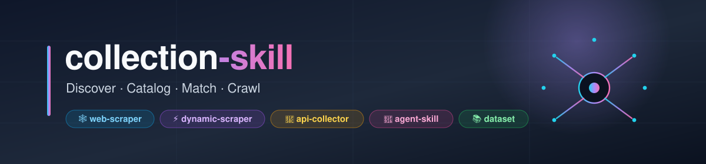
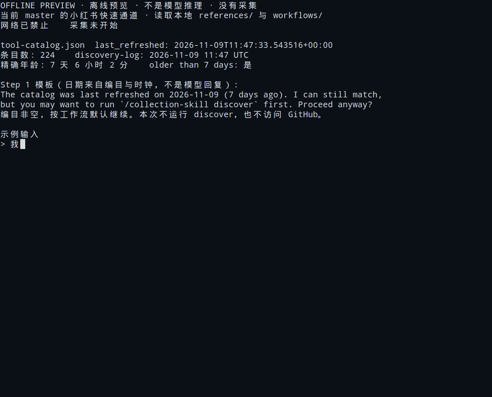
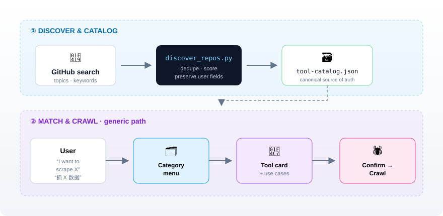
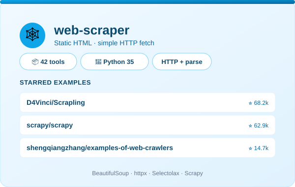
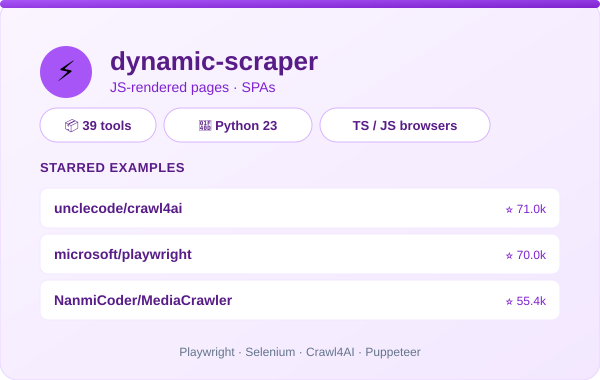
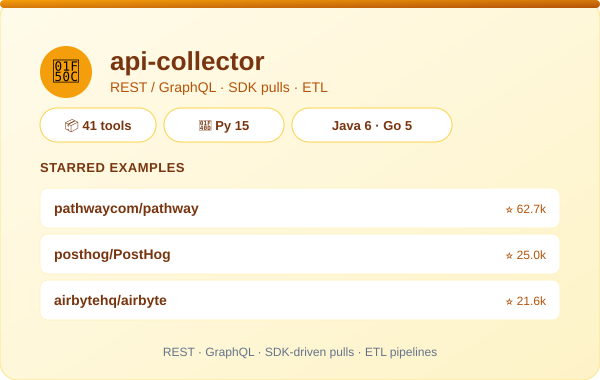
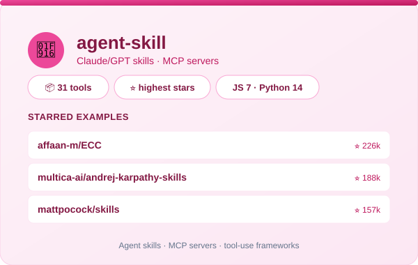
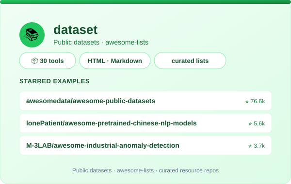

<p align="center">
  
</p>

<p align="center">
  
  <br/>
  <sub>Vista previa offline de la ruta rápida actual de Xiaohongshu, leída de archivos locales. Sin inferencia en vivo ni recolección.</sub>
</p>

<h3 align="center">
  Descubrir · Catalogar · Elegir · Recolectar
</h3>

<p align="center">
  <a href="README.md">English</a> ·
  <a href="README.zh-CN.md">简体中文</a> ·
  <a href="README.ja.md">日本語</a> ·
  <a href="README.es.md">Español</a>
</p>

<p align="center">
  
  
  
  
  
  
  <a href="https://github.com/Yuuqq/collection-skill/actions/workflows/discover.yml"></a>
</p>

---

> Una skill que elige —y ejecuta— el crawler adecuado para **plataformas sociales y de e-commerce chinas** (小红书, 抖音, bilibili, 微博, 知乎, 快手, 淘宝 …), tras una puerta de cumplimiento. Respaldada por un catálogo auto-actualizado de scrapers, colectores de API, skills MCP y datasets que también cubre cualquier otro sitio o API.

## ✨ Características

| | |
|:--|:--|
| 🇨🇳 **Vía rápida china** | Nombra una plataforma (小红书 / 抖音 / 微博 / 淘宝…) → lista corta + recordatorio de cumplimiento, sin menú genérico. |
| 🗂️ **Catálogo curado** | Descubre repos en GitHub y los clasifica en **cinco categorías canónicas**, sin duplicados y ordenados por estrellas dentro de cada categoría. |
| 🧭 **Divulgación progresiva** | Nunca vuelca todo el catálogo — menú de categorías → ficha de herramienta → flujo → recolección. |
| 🗃️ **JSON como fuente** | `tool-catalog.json` es la única fuente de verdad; la vista Markdown se genera. |
| 🔐 **Seguro por defecto** | Lee tokens desde el llavero de `gh` / variables de entorno — sin credenciales en el repo. |
| ⏱️ **Programable** | Instala una actualización periódica vía cron / Programador de tareas. |

## 📥 Instalación

Funciona con cualquier agente que soporte el formato abierto [Agent Skills](https://agentskills.io) — Claude Code, Cursor, Codex y más:

```bash
npx skills add Yuuqq/collection-skill
```

<details>
<summary>Instalación manual (git clone)</summary>

Clona en el directorio de skills de tu agente:

```bash
# Claude Code (personal)
git clone https://github.com/Yuuqq/collection-skill.git ~/.claude/skills/collection-skill

# Cursor
git clone https://github.com/Yuuqq/collection-skill.git ~/.cursor/skills/collection-skill

# Codex
git clone https://github.com/Yuuqq/collection-skill.git ~/.codex/skills/collection-skill

# o por proyecto: .claude/skills/ · .cursor/skills/ · .codex/skills/
```

</details>

> Los scripts de descubrimiento requieren Python 3.10+; autentícate con [`gh` CLI](https://cli.github.com/) o `GITHUB_TOKEN` para límites más altos de la API de GitHub.

## 📦 Qué hace

Dos mitades que comparten **una base de conocimiento**:

<p align="center">
  
</p>

### ① Descubrir & Catalogar
Escanea GitHub periódicamente en busca de repos *de recolección*, en cinco categorías:

| Etiqueta | Significado | Ejemplos |
|----------|-------------|----------|
| 🕸️ `web-scraper` | HTML estático / HTTP simple | BeautifulSoup, httpx, Selectolax, Scrapy |
| ⚡ `dynamic-scraper` | Páginas con JS, SPA | Playwright, Selenium, Crawl4AI |
| 🔌 `api-collector` | REST/GraphQL, SDK, ETL | recolectores por SDK, pipelines |
| 🤖 `agent-skill` | Skills de Claude/GPT, servidores MCP | frameworks de uso de herramientas |
| 📚 `dataset` | Datasets públicos, awesome-lists | repos curados de recursos |

### ② Elegir & Recolectar
Nombrar una plataforma china (小红书/抖音/微博/公众号/淘宝…) salta el embudo:

```
recordatorio de cumplimiento  →  lista corta por plataforma  →  cargar flujo  →  confirmar alcance  →  recolectar
```

Para cualquier otro objetivo, decir *"quiero extraer X"* recorre un embudo corto:

```
menú de categorías  →  ficha de herramienta  →  cargar flujo  →  confirmar alcance  →  recolectar
```

## ⚠️ Cumplimiento

La mayoría de los crawlers de plataformas chinas del catálogo son implementaciones comunitarias de ingeniería inversa y violan los términos de servicio de esas plataformas. Esta skill los cataloga con fines de investigación / uso autorizado y siempre muestra un recordatorio de cumplimiento antes de seleccionar una herramienta. **El uso lícito es tu responsabilidad**: respeta los ToS y `robots.txt`, mantén tasas de petición bajas, recoge datos personales solo con base legal (anonimiza cuando puedas) y no reutilices contenido capturado comercialmente sin autorización. La skill no ayuda a evadir sistemas anti-bot ni de control de riesgo.

## 📊 Estado del catálogo

> Generado desde `tool-catalog.json` · última actualización `2026-11-23`

| Categoría | Cuenta | | Lenguajes principales |
|-----------|-------:|---|------------------------|
| 🕸️ web-scraper | 55 | | Python · Java · Jupyter Notebook |
| 🔌 api-collector | 49 | | Python · Rust · Go |
| ⚡ dynamic-scraper | 51 | | Python · TypeScript · HTML |
| 🤖 agent-skill | 45 | | Python · TypeScript · JavaScript |
| 📚 dataset | 32 | | Python · HTML · JavaScript |
| **Total** | **232** | | **Python (124)** lidera |

> 🆕 **Cada semana entran herramientas nuevas.** El catálogo se actualiza semanalmente — mira las novedades en cada [resumen semanal](../../releases). Marca el repo con **Watch** para recibir avisos.

## 🎴 Tarjetas por categoría

<table>
  <tr>
    <td width="50%" align="center"><br><sub><a href="docs/card-web-scraper.svg">🕸️ web-scraper · 55 herramientas</a></sub></td>
    <td width="50%" align="center"><br><sub><a href="docs/card-dynamic-scraper.svg">⚡ dynamic-scraper · 51 herramientas</a></sub></td>
  </tr>
  <tr>
    <td width="50%" align="center"><br><sub><a href="docs/card-api-collector.svg">🔌 api-collector · 49 herramientas</a></sub></td>
    <td width="50%" align="center"><br><sub><a href="docs/card-agent-skill.svg">🤖 agent-skill · 45 herramientas</a></sub></td>
  </tr>
  <tr>
    <td colspan="2" align="center"><br><sub><a href="docs/card-dataset.svg">📚 dataset · 32 herramientas</a></sub></td>
  </tr>
</table>

## 🚀 Uso

Invoca la skill y habla con naturalidad:

| Dices | Qué ocurre |
|-------|------------|
| `小红书 notas` / `抖音 comentarios` / `weibo hot search` | Vía rápida: lista corta por plataforma + puerta de cumplimiento → recolección |
| `refresh` / `discover` / `actualizar` | Ejecuta `scripts/discover_repos.py`, actualiza el catálogo |
| `quiero extraer X` / `抓 X 数据` | Divulgación progresiva → categorías → ficha → recolección |
| `browse` / `ver catálogo` | Vista de solo lectura de categorías/fichas |
| `schedule` / `programar` | Instala una actualización periódica (cron / Programador de tareas) |

## 🛠️ Inicio rápido

```bash
# 1. (recomendado) autenticarse — 30 req/min de búsqueda vs 10 sin autenticar
gh auth login

# 2. primera actualización
python scripts/discover_repos.py
python scripts/build_catalog_md.py
python scripts/sync_readme_stats.py

# 3. (opcional) programar actualización semanal — invoca la skill y di "programar"
```

## 🤖 Evaluación con LLM (opcional)

Con `LLM_API_KEY` configurada, el descubrimiento envía por defecto todo el catálogo, incluidos los candidatos nuevos, a un endpoint compatible con OpenAI. El modelo propone la inclusión, la categoría y los usos; las entradas curadas están protegidas y las señales de recolección evitan exclusiones erróneas. Usa `--no-rescan` para evaluar solo entradas nuevas o actualizadas, o `--no-llm` para usar la heurística incluso si hay clave. Consulta la [guía de evaluación con LLM](references/llm-judging.md) para configurar el endpoint y el conjunto de claves.

El flujo [Discover & Catalog](.github/workflows/discover.yml) actualiza el catálogo los lunes a las 03:17 UTC. Configura `GH_PAT` en **Settings → Secrets** para autenticar las búsquedas y enviar los cambios. `LLM_API_KEY` es opcional; sin clave se usa la heurística. Desde la pestaña Actions también puedes lanzarlo manualmente, indicar `categories` separadas por espacios o desactivar `llm`. Tras un descubrimiento exitoso, [Weekly Digest](.github/workflows/weekly-digest.yml) publica una GitHub Release si hay entradas descubiertas en los últimos siete días.

## 🗺️ Estructura del proyecto

```
collection-skill/
├── SKILL.md                       # Enrutador + principios esenciales
├── workflows/
│   ├── discover-catalog.md        # Actualizar desde GitHub
│   ├── match-and-crawl.md         # Divulgación progresiva → recolección
│   ├── browse-catalog.md          # Vista de solo lectura
│   ├── schedule-refresh.md        # Instalar actualización periódica
│   └── tools/                     # Flujos de recolección por herramienta
├── references/
│   ├── tool-catalog.json          # Dato canónico (edita esto)
│   ├── tool-catalog.md            # Vista generada (no editar)
│   ├── discovery-log.md           # Historial de solo anexión
│   ├── category-keywords.md       # Términos de búsqueda por categoría
│   ├── repo-schema.md             # Esquema de entrada
│   ├── rate-limit-guide.md        # Límites de la API de GitHub
│   ├── chinese-social-platforms.md # Alias y etiquetas de plataformas
│   └── llm-judging.md             # Evaluación opcional y protecciones
├── templates/
│   ├── crawl-template.md          # Flujo de recolección genérico
│   ├── discovery-log-entry.md
│   └── run_scheduled_refresh.sh.template
├── scripts/
│   ├── discover_repos.py          # Búsqueda en GitHub → catálogo
│   ├── build_catalog_md.py        # JSON → Markdown
│   ├── validate_catalog.py        # Validar repo-schema.md antes de escribir
│   ├── add_repo.py                # Añadir una entrada manualmente
│   ├── sync_readme_stats.py       # Actualizar cifras de los README traducidos
│   ├── make_digest.py             # Generar un resumen de entradas nuevas
│   └── offline_demo_walk.py       # Reproducir la demo sin conexión
└── docs/                          # Banners y diagramas del README
```

## ⚖️ Reglas de diseño

- **JSON es canónico.** `tool-catalog.md` se regenera con `build_catalog_md.py` — nunca lo edites a mano.
- **Divulgación progresiva.** Primero categorías, luego fichas, y el flujo solo tras elegir herramienta.
- **Sin credenciales en el repo.** Los tokens provienen de `$GITHUB_TOKEN` o `gh auth token`.
- **Campos de usuario preservados.** El redescubrimiento nunca sobrescribe `notes`, `verified`, `favorite`, `workflow_file`.
- **Respeta los límites.** Honra `robots.txt`, los límites de tasa y los términos; confirma el alcance antes de recolectar en un dominio nuevo.

## 🤝 Aporta una herramienta

¿Conoces un scraper, colector, agent skill o dataset que falte? Solo toma 30 segundos:

- **Abre un [issue de propuesta](../../issues/new?template=submit-tool.yml)** — lo revisamos para valorar su inclusión.
- **O envía un PR** — consulta [CONTRIBUTING.md](CONTRIBUTING.md) para las reglas del catálogo y el patrón de workflows por herramienta.

Cada propuesta mejora el catálogo para todos. 🙌

## 🌍 Traducciones

| Idioma | Archivo |
|--------|---------|
| English | [`README.md`](README.md) |
| 简体中文 | [`README.zh-CN.md`](README.zh-CN.md) |
| 日本語 | [`README.ja.md`](README.ja.md) |
| Español | [`README.es.md`](README.es.md) |

## 📄 Licencia

MIT — ver [LICENSE](LICENSE).
