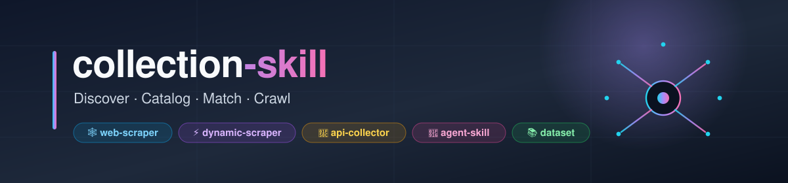
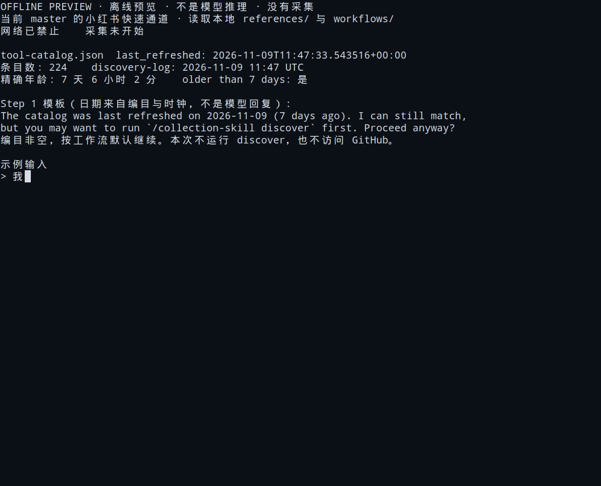
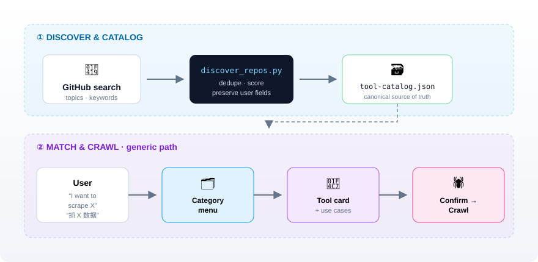
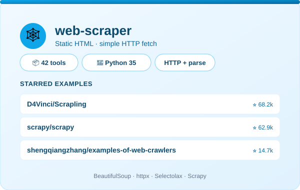
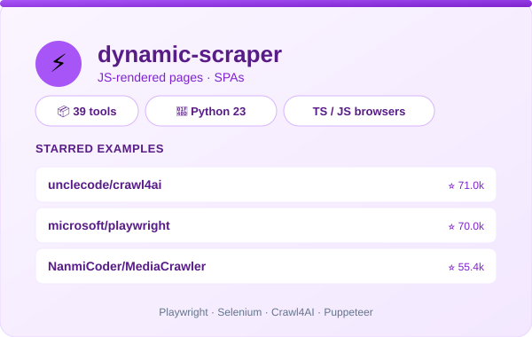
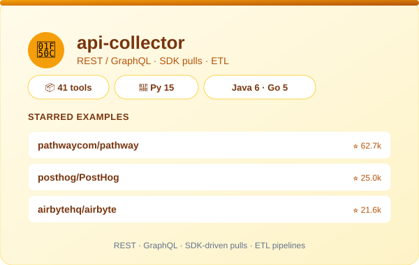
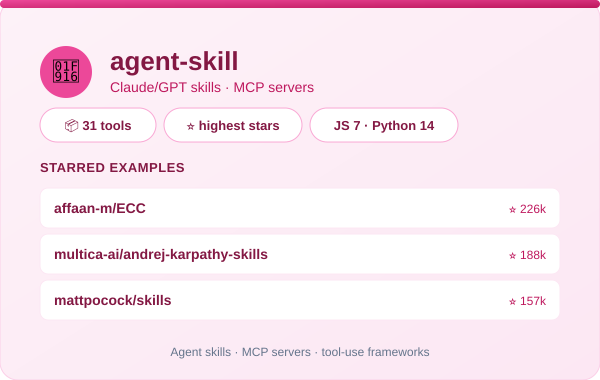
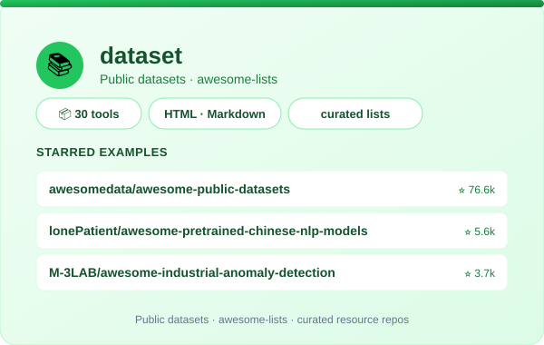

<p align="center">
  
</p>

<p align="center">
  
  <br/>
  <sub>現行の小紅書ファストパスをローカルファイルから再生したオフラインプレビュー。ライブ推論でも実収集でもありません。</sub>
</p>

<h3 align="center">
  発見 · カタログ化 · 選定 · クロール
</h3>

<p align="center">
  <a href="README.md">English</a> ·
  <a href="README.zh-CN.md">简体中文</a> ·
  <a href="README.ja.md">日本語</a> ·
  <a href="README.es.md">Español</a>
</p>

<p align="center">
  
  
  
  
  
  
  <a href="https://github.com/Yuuqq/collection-skill/actions/workflows/discover.yml"></a>
</p>

---

> **中国 SNS・EC プラットフォーム向けクローラー選定**スキル —— 小紅書 / 抖音 / bilibili / 微博 / 知乎 / 快手 / 公衆号 / 淘宝 などプラットフォーム名を言うだけで、コンプライアンスゲート付きの絞り込み候補からクロールを開始。背後には自動更新の収集ツールカタログ(スクレイパー / API コレクター / MCP スキル / データセット)があり、他のあらゆるサイト・API もカバー。

## ✨ 主な特徴

| | |
|:--|:--|
| 🇨🇳 **中国 SNS 高速パス** | プラットフォーム名(小紅書 / 抖音 / 微博 / 淘宝…)→ 絞り込み候補 + コンプライアンスリマインダー。汎用メニューは省略。 |
| 🗂️ **厳選カタログ** | GitHub リポジトリを**5つの標準カテゴリ**に自動分類し、重複を除いてカテゴリごとにスター数順で表示。 |
| 🧭 **段階的開示** | カタログを一括表示しない —— カテゴリメニュー → ツールカード → ワークフロー → クロール。 |
| 🗃️ **JSON が正** | `tool-catalog.json` が唯一の信頼源、Markdown ビューは自動生成。 |
| 🔐 **デフォルトで安全** | トークンは `gh` キーリング / 環境変数から —— リポジトリに資格情報は置かない。 |
| ⏱️ **スケジュール対応** | cron / タスクスケジューラで定期更新をインストール可能。 |

## 📥 インストール

オープンな [Agent Skills](https://agentskills.io) 仕様に対応する任意のエージェントで動作します —— Claude Code、Cursor、Codex など:

```bash
npx skills add Yuuqq/collection-skill
```

<details>
<summary>手動インストール(git clone)</summary>

エージェントの skills ディレクトリへクローン:

```bash
# Claude Code(個人)
git clone https://github.com/Yuuqq/collection-skill.git ~/.claude/skills/collection-skill

# Cursor
git clone https://github.com/Yuuqq/collection-skill.git ~/.cursor/skills/collection-skill

# Codex
git clone https://github.com/Yuuqq/collection-skill.git ~/.codex/skills/collection-skill

# プロジェクト単位: .claude/skills/ · .cursor/skills/ · .codex/skills/
```

</details>

> 発見スクリプトには Python 3.10+ が必要。[`gh` CLI](https://cli.github.com/) または `GITHUB_TOKEN` で認証すると GitHub API の制限が緩和されます。

## 📦 何をするか

**1つのナレッジベース**を共有する2つの機能:

<p align="center">
  
</p>

### ① 発見 & カタログ化
定期的に GitHub を走査し、*収集系*リポジトリを5カテゴリに分類:

| タグ | 意味 | 例 |
|-----|------|-----|
| 🕸️ `web-scraper` | 静的 HTML / 単純な HTTP 取得 | BeautifulSoup、httpx、Selectolax、Scrapy |
| ⚡ `dynamic-scraper` | JS レンダリング、SPA | Playwright、Selenium、Crawl4AI |
| 🔌 `api-collector` | REST/GraphQL、SDK 取得、ETL | SDK 駆動コレクター、パイプライン |
| 🤖 `agent-skill` | Claude/GPT スキル、MCP サーバー | ツール使用フレームワーク |
| 📚 `dataset` | 公開データセット、awesome リスト | 厳選リソースリポジトリ |

### ② 選定 & クロール
中国系プラットフォーム名(小紅書/抖音/微博/公衆号/淘宝…)を挙げるとファネルを短絡します:

```
コンプライアンスリマインダー  →  プラットフォーム別の候補  →  ワークフロー読込  →  範囲の確認  →  クロール
```

その他の対象は「*X をスクレイプしたい*」から短いファネルへ:

```
カテゴリメニュー  →  ツールカード  →  ワークフロー読込  →  範囲確認  →  クロール
```

## ⚠️ コンプライアンス

カタログ内の中国系プラットフォーム向けクローラーの多くはコミュニティによるリバースエンジニアリング実装で、プラットフォームの利用規約に違反します。本スキルは研究・許諾済み利用のための情報として収録し、ツール提示の前に必ずコンプライアンスリマインダーを表示します。**合法的な利用は使用者の責任**です:利用規約と `robots.txt` を守り、リクエスト率を抑え、個人データは正当な根拠のある場合のみ収集(可能な限り匿名化)し、無断での商用利用はしないでください。本スキルはアンチボット・リスクコントロール機構の回避を支援しません。

## 📊 カタログ概況

> `tool-catalog.json` から自動生成 · 最終更新 `2026-11-23`

| カテゴリ | 件数 | | 主要言語 |
|----------|----:|---|----------|
| 🕸️ web-scraper | 55 | | Python · Java · Jupyter Notebook |
| 🔌 api-collector | 49 | | Python · Rust · Go |
| ⚡ dynamic-scraper | 51 | | Python · TypeScript · HTML |
| 🤖 agent-skill | 45 | | Python · TypeScript · JavaScript |
| 📚 dataset | 32 | | Python · HTML · JavaScript |
| **合計** | **232** | | **Python(124)** が最多 |

> 🆕 **毎週新しいツールが追加されます。** カタログは毎週自動更新されます。新規追加は[週次ダイジェスト](../../releases)で確認できます。Watch すると通知が届きます。

## 🎴 カテゴリカード

<table>
  <tr>
    <td width="50%" align="center"><br><sub><a href="docs/card-web-scraper.svg">🕸️ web-scraper · 55ツール</a></sub></td>
    <td width="50%" align="center"><br><sub><a href="docs/card-dynamic-scraper.svg">⚡ dynamic-scraper · 51ツール</a></sub></td>
  </tr>
  <tr>
    <td width="50%" align="center"><br><sub><a href="docs/card-api-collector.svg">🔌 api-collector · 49ツール</a></sub></td>
    <td width="50%" align="center"><br><sub><a href="docs/card-agent-skill.svg">🤖 agent-skill · 45ツール</a></sub></td>
  </tr>
  <tr>
    <td colspan="2" align="center"><br><sub><a href="docs/card-dataset.svg">📚 dataset · 32ツール</a></sub></td>
  </tr>
</table>

## 🚀 使い方

スキルを呼び出したら、自然な言葉で指示:

| 言うこと | 何が起きるか |
|---------|--------------|
| `小紅書ノート` / `抖音コメント` / `weibo hot search` | 高速パス:プラットフォーム絞り込み + コンプライアンスゲート → クロール |
| `refresh` / `discover` / `更新` | `scripts/discover_repos.py` を実行、カタログを更新 |
| `X をスクレイプしたい` / `抓 X 数据` | 段階的開示 → カテゴリ → カード → クロール |
| `browse` / `カタログを見せて` | 読み取り専用のカテゴリ/カード表示 |
| `schedule` / `定期実行` | 定期更新をインストール(cron / タスクスケジューラ) |

## 🛠️ クイックスタート

```bash
# 1.(推奨)認証 —— 認証済みなら検索 30 req/分、未認証は 10 req/分
gh auth login

# 2. 初回更新
python scripts/discover_repos.py
python scripts/build_catalog_md.py
python scripts/sync_readme_stats.py

# 3.(任意)毎週の更新を予約 —— スキルを呼び出して「定期更新」と発話
```

## 🤖 LLM ジャッジ(オプション)

`LLM_API_KEY` を設定すると、発見スクリプトは既定で新規候補を含むカタログ全体を OpenAI 互換エンドポイントに送ります。モデルは採否・カテゴリ・用途を提案しますが、人の手で選定した項目は保護され、収集に関連する特徴があれば誤って除外されません。`--no-rescan` で今回の新規・更新項目だけを評価でき、`--no-llm` でキーがあってもヒューリスティックを使えます。エンドポイントやキープールの設定は [LLM ジャッジの詳細](references/llm-judging.md) を参照してください。

[Discover & Catalog ワークフロー](.github/workflows/discover.yml)は毎週月曜 03:17 UTC にカタログを更新します。認証付き検索と更新のプッシュには **Settings → Secrets** で `GH_PAT` を設定します。`LLM_API_KEY` は任意で、未設定ならヒューリスティックを使います。Actions ページから手動実行する場合は、空白区切りの `categories` を指定したり、`llm` を無効にしたりできます。発見ワークフローの成功後、直近7日間に新規登録があれば [Weekly Digest](.github/workflows/weekly-digest.yml) が GitHub Release を公開します。

## 🗺️ プロジェクト構成

```
collection-skill/
├── SKILL.md                       # ルーター + 基本原則
├── workflows/
│   ├── discover-catalog.md        # GitHub から更新
│   ├── match-and-crawl.md         # 段階的開示 → クロール
│   ├── browse-catalog.md          # 読み取り専用ビュー
│   ├── schedule-refresh.md        # 定期更新のインストール
│   └── tools/                     # ツール別クロールワークフロー
├── references/
│   ├── tool-catalog.json          # 正データ(ここを編集)
│   ├── tool-catalog.md            # 生成ビュー(編集不可)
│   ├── discovery-log.md           # 追記型の実行履歴
│   ├── category-keywords.md       # カテゴリ別の検索キーワード
│   ├── repo-schema.md             # エントリのスキーマ
│   ├── rate-limit-guide.md        # GitHub API の制限
│   ├── chinese-social-platforms.md # プラットフォームの別名とタグ
│   └── llm-judging.md             # 任意の判定と保護ルール
├── templates/
│   ├── crawl-template.md          # 汎用クロールワークフロー
│   ├── discovery-log-entry.md
│   └── run_scheduled_refresh.sh.template
├── scripts/
│   ├── discover_repos.py          # GitHub 検索 → カタログ
│   ├── build_catalog_md.py        # JSON → Markdown
│   ├── validate_catalog.py        # 書き込み前にスキーマ検証
│   ├── add_repo.py                # 手動でエントリを追加
│   ├── sync_readme_stats.py       # 各言語の README の統計を更新
│   ├── make_digest.py             # 新規登録項目のダイジェストを生成
│   └── offline_demo_walk.py       # ローカルファイルでオフラインデモを再生
└── docs/                          # README のバナーと図
```

## ⚖️ 設計ルール

- **JSON が正。** `tool-catalog.md` は `build_catalog_md.py` で再生成されます —— 手動編集禁止。
- **段階的開示。** まずカテゴリ、次にカード、ツール決定後にワークフローを読み込む。
- **資格情報は置かない。** トークンは `$GITHUB_TOKEN` または `gh auth token` から取得。
- **ユーザーフィールドは保持。** 再発見時にも `notes`、`verified`、`favorite`、`workflow_file` は上書きしない。
- **境界を尊重。** `robots.txt`、レート制限、利用規約を遵守。新ドメインのクロール前に範囲を確認。

## 🤝 ツールを提案する

まだ載っていない優れたスクレイパー・コレクター・agent skill・データセットをご存知ですか？30 秒で提案できます：

- **[ツール提案 issue](../../issues/new?template=submit-tool.yml)を開く** —— 内容を確認して掲載を検討します。
- **または PR を送る** —— カタログのルールとツール別 workflow のパターンは [CONTRIBUTING.md](CONTRIBUTING.md) を参照してください。

提案ひとつひとつが、カタログをみんなにとって便利にします。🙌

## 🌍 多言語版

| 言語 | ファイル |
|------|---------|
| English | [`README.md`](README.md) |
| 简体中文 | [`README.zh-CN.md`](README.zh-CN.md) |
| 日本語 | [`README.ja.md`](README.ja.md) |
| Español | [`README.es.md`](README.es.md) |

## 📄 ライセンス

MIT —— [LICENSE](LICENSE) を参照。
